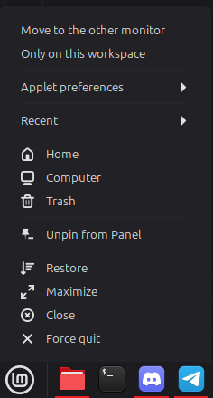

# Force Quit from Panel

A Cinnamon extension that adds **Force quit** (or **Force quit all** for grouped
windows) to the right-click menu of apps in the stock *Grouped window list* panel
applet, right below *Close*. It kills frozen apps that ignore Alt+F4.



## How it works

It calls `Meta.Window.kill()`, the same thing Cinnamon's "not responding → Force
Quit" dialog uses: `SIGKILL` to the window's process (PID resolved through the X
server, so it is correct for Flatpak apps too), falling back to `XKillClient`.

It does not fork the applet. Cinnamon caches xlet modules by path, so the extension
patches the applet's menu class at runtime: pinned apps and settings stay untouched,
every panel gets the item, and upstream updates to the applet keep arriving.

## Install

From Cinnamon Spices: *System Settings → Extensions → Download*, search for
**Force Quit from Panel**.

From this repository:

```sh
ln -sfn "$PWD/force-quit-menu@J0nathan550/files/force-quit-menu@J0nathan550" \
    ~/.local/share/cinnamon/extensions/
```

Then enable it in *System Settings → Extensions*.

The folder follows the [Cinnamon Spices](https://github.com/linuxmint/cinnamon-spices-extensions)
layout, so it can be copied there as-is.

## Tip: show running apps on every monitor's panel

With a panel on each monitor: right-click the window list on each panel →
*Configure...* → **Show windows from other monitors → From all monitors**.

## License

GPL-3.0
